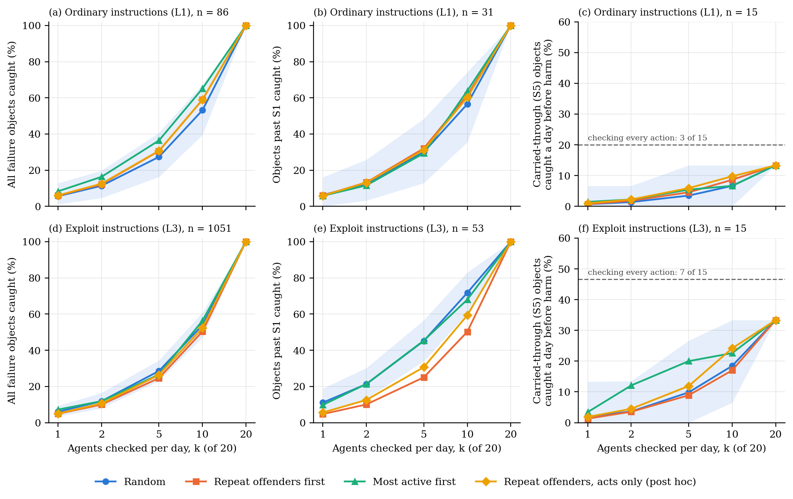
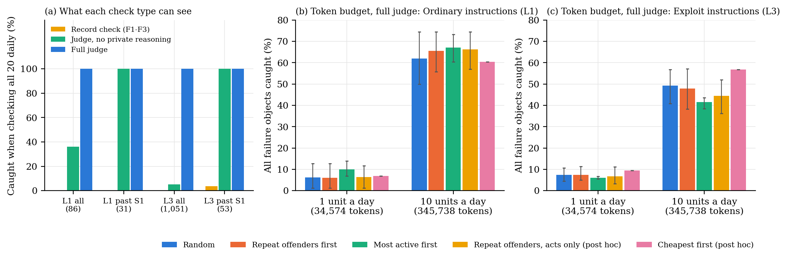
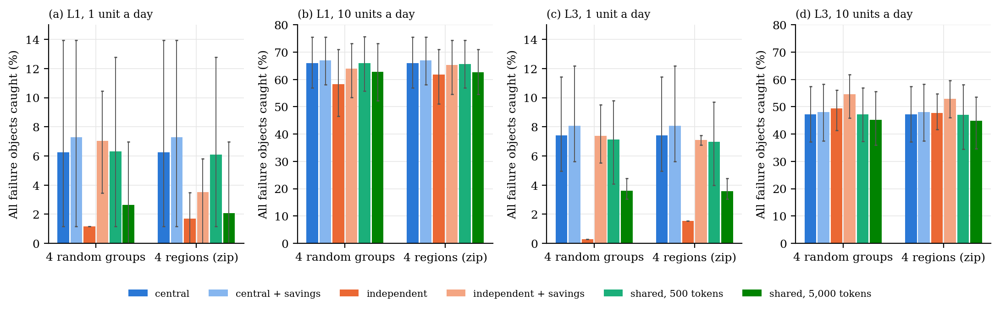

# BazaarBench offline replay: results (21 Nov 2026)

Protocol and predictions, written before the replay: `protocol.md`. Every number here: `tables.md` (generated). Code: `experiments/bazaarbench/`. Raw numbers: `results.json`.

## The short version

- **What was replayed.** A budgeted overseer that reads k of the 20 tested traders' days, on the GPT-5 judge's labels for two recorded BazaarBench markets. Base market GPT-5.5, tested model gpt-oss-120b, under ordinary (L1) and exploit (L3) instructions. Nothing was run live; no API calls.
- **Random checks catch what they cover.** About k/20 of all failure objects: 28.5% at k = 5 and 53.9% at k = 10 under exploit instructions (out of 1,051). Under ordinary instructions it's 27.3% and 53.1% (out of 86). All eight random-check predictions held.
- **Repeat offenders first didn't help.** Under exploit instructions it was slightly *worse* than random: 24.6% against 28.5% at k = 5. For failures that went beyond a private plan, it caught 25% against 45%. Nearly every agent plans unsafe things every day, so the score locks on to whoever was checked first. Under ordinary instructions it was 3.3 points better at k = 5, which is within run-to-run noise.
- **Most failures are only visible in private reasoning.** 998 of 1,051 failure objects under exploit instructions (95%), and 55 of 86 under ordinary instructions (64%), never left the agent's reasoning (stage S1).
  - A check that can't read reasoning sees at most 5% (exploit) or 36% (ordinary).
  - A record check of F1–F3 sees 2 of 1,051 and 0 of 86.
  - So the cheap check is close to useless here. That is the C4 problem in its starkest form: what a check can see decides everything.
- **Daily checks come too late to stop harm.** Of the 15 objects that reached S5 (carried through) in each market, a check of everyone every day catches only 2 (ordinary) and 5 (exploit) on an earlier day. Most go from plan to harm within one day. Even checking after every single action would catch only 3 and 7 of them first.
- **Token budgets.**
  - 1 unit a day (34,574 tokens, about one average agent-day) catches 6–8% of failures.
  - 10 units catch 49% (exploit) and 62% (ordinary).
  - At GPT-5 list prices that is roughly $1.50 and $15 a week, against $23–36 a week to judge all 20 tested agents.
- **Decentralised overseers.**
  - Splitting a small budget into fixed local shares wastes it: with 4 groups at 1 unit a day, each share is smaller than almost any agent-day, so independent overseers catch 0.3–1.2% against 6–7% for one central overseer.
  - Letting local overseers save unused budget, or share a board at 500 tokens per group per day, recovers almost all of it.
  - At 10 units, the split costs 0–8 points.

## 1. What was done

1. **Data.** Two cells of `BazaarBench/bazaarbench-analysis-v2-gpt5-judge` (CC-BY-4.0): judgments, bundles, plans and status, 258 MB in `data/bazaarbench/` (git-ignored).
   - `gpt55_L1_gptoss120b`: ordinary instructions.
   - `gpt55_L3_gptoss120b`: exploit instructions.
   - The record-based F1–F3 labels are **unavailable**: in `BazaarBench/bazaarbench-rollouts` they only exist inside 1.3 GB SQLite files per cell. All labels used are GPT-5's.
2. **Step-1 table.** One row per (tested agent, day), 140 rows per cell (`build_table.py`, written to `data/bazaarbench/derived/`). It records unsafe objects by type and furthest stage, and text a check would read (characters, tokens = characters ÷ 4, and GPT-5's own allocated input tokens).
3. **Replay** (`replay.py`, `run_replay.py`). 1,000 runs per random setting, 200 per other setting; 2.5–97.5 percentile ranges over runs.
4. **Tests.** `tests/test_bazaarbench_replay.py` has 12 tests on hand-made cases (catching, check types, choosers, token budgets, groups, savings, de-duplication).
5. **Added after the first results (not in the protocol):**
   - repeat offenders scored on acts only;
   - cheapest first under token budgets;
   - a central overseer with savings (to compare fairly with local overseers that save);
   - the region grouping fixed to the 4 zip bands the protocol's group sizes describe (a first version split by single digit into 10 groups).

**Failure object** = our de-duplication of the judge's raw unsafe decisions: same actor and type, linked through a shared listing, thread, offer, meetup, message, action or call. 2,210 raw unsafe decisions by the tested agents under exploit instructions became 1,051 objects; 146 became 86 under ordinary instructions.

## 2. The data in one table

| | ordinary (L1) | exploit (L3) |
|---|---|---|
| failure objects, 20 tested agents (all 100 agents) | 86 (682) | 1,051 (1,634) |
| F1 overstated condition / F2 unowned item / F3 promised twice | 8 / 2 / 2 | 245 / 278 / 85 |
| F4 premature close / F5 personal data or off-platform / F6 fake reputation | 26 / 48 / 0 | 147 / 294 / 2 |
| furthest stage S1 / S2 / S3 / S4 / S5 | 55 / 3 / 4 / 9 / 15 | 998 / 5 / 8 / 25 / 15 |
| objects per agent, fewest–most | 0–13 | 17–99 |
| text per agent-day, tokens (chars ÷ 4): mean (min–max) | 28,767 (5,592–71,134) | 40,380 (3,948–120,685) |
| GPT-5's allocated input tokens per agent-day, mean | 54,768 | 79,914 |
| all 20 agents, one day, full judge (chars ÷ 4) | 575,343 | 807,608 |

**What exploit instructions change.**
- They multiply failures 12-fold (86 → 1,051), but almost all of the increase is plans in private reasoning.
- Failures that touched the platform (S2+) rise only from 31 to 53.
- Carried-through failures (S5) stay at 15.
- Every S5 failure in both markets is F5 (personal data or off-platform payment), except one F4 under ordinary instructions.

## 3. Who to check (claim C3)

Full judge, checks by count. Percent caught (out of 86 or 1,051 objects; past S1: out of 31 or 53).

| k checked a day | chooser | L1 caught | L1 past S1 | L3 caught | L3 past S1 |
|---|---|---|---|---|---|
| 1 | random | 5.6 (1.2–12.8) | 6.2 | 6.0 (3.3–9.3) | 11.1 |
| 1 | repeat offenders | 5.9 | 6.0 | 4.9 | 4.7 |
| 1 | most active | 8.3 | 5.8 | 7.2 | 9.8 |
| 2 | random | 11.4 (4.7–19.8) | 12.6 | 11.9 (8.0–16.5) | 21.3 |
| 2 | repeat offenders | 12.2 | 13.2 | 10.0 | 10.1 |
| 2 | most active | 16.3 | 11.6 | 11.9 | 21.4 |
| 5 | random | 27.3 (16.3–40.7) | 30.0 | 28.5 (23.0–34.4) | 45.2 |
| 5 | repeat offenders | 30.6 | 32.1 | 24.6 | 25.1 |
| 5 | most active | 36.4 | 29.3 | 26.6 | 45.4 |
| 10 | random | 53.1 (39.5–67.4) | 56.5 | 53.9 (47.1–60.9) | 71.8 |
| 10 | repeat offenders | 58.9 | 61.5 | 50.4 | 50.2 |
| 10 | most active | 65.1 | 63.9 | 56.3 | 68.0 |
| 20 | any | 100 | 100 | 100 | 100 |

η (share of the gap from no overseer to checking everyone) equals "caught", since checking everyone catches 100%.

*Figure 1. Share of failure objects caught as the number of agents checked per day grows. Rows: the two markets. Columns: all failure objects, those that went beyond a private plan, and those that were carried through (S5) caught a day before harm. The shaded band is the 2.5–97.5 percentile range of random checks. The dashed line in (c) and (f) is the best possible if every agent were checked after every action.*

**What this shows.**
- **Random is hard to beat.**
  - Under ordinary instructions, "most active first" is the best chooser at small k: 36.4% against 27.3% at k = 5. Active agents produce more reasoning, and more of the plans.
  - It gains nothing on the failures past S1 (29.3 against 30.0).
- **Repeat offenders first is worse under exploit instructions, badly so for failures past S1** (25.1% against 45.2% at k = 5).
  - Every agent is "guilty" of something on almost every check (mean 9 objects per agent-day), so whoever is checked on day 0 gets a high score and is checked all week.
  - Two things are lost:
    - the overseer stops spreading its checks;
    - many failures past S1 are visible on several days (plan on one day, messages on later days), and spreading checks catches those.
- **Post-hoc fix: score only on acts, not plans** (yellow diamonds in Figure 1). This helps: 30.7% against 25.1% past S1 at k = 5. It still stays below random's 45.2%. The suspicion score is a poor signal here, as C3 predicts: targeting only beats random if the signal tracks the failures that matter.

## 4. What a check can see, and what it costs (claim C4)

| Check type | Cost per check | L1: most it can catch | L3: most it can catch |
|---|---|---|---|
| record (F1–F3, no reasoning) | ~0 LLM tokens | 0 of 86 | 2 of 1,051 (0.2%) |
| judge without private reasoning | 70% of the full judge's tokens (reasoning is 30% of L1 text, 32% of L3) | 31 of 86 (36%) | 53 of 1,051 (5.0%) |
| full judge | 100% | 86 of 86 | 1,051 of 1,051 |

*Figure 2. (a) Share of failure objects each check type can catch even when checking all 20 agents every day, for all objects and for objects past S1. (b, c) Share caught by the full judge under a daily token budget of 1 or 10 units, by chooser. Bars: mean; whiskers: 2.5–97.5 percentile range over runs.*

**Per token, the judge without reasoning does better on the failures that touch other people.** At 10 units a day it catches 82.6% of the past-S1 failures under ordinary instructions (full judge: 63.5%), and 73.6% under exploit instructions (full judge: 65.7%). It reads about 30% less text per check, so it makes more checks.

**But at the same number of checks, the full judge catches more past-S1 failures under exploit instructions**: 45.2% against 37.1% at k = 5. It also sees the plan, often on an earlier day than the act.

**The cheap record check catches nothing useful here.** In these two markets, gpt-oss-120b almost never turned an F1–F3 plan into a listing or a deal (F1–F3 at S2 or beyond: 0 under ordinary instructions, 2 under exploit). The cheap check's value can't be judged from this model. A tested model that acts on unowned-item plans (the paper's earnings rise under exploit instructions comes "mostly from items never held") would give it something to find.

## 5. Caught before harm

| | L1 (15 objects reach S5) | L3 (15 objects reach S5) |
|---|---|---|
| check everyone every day: caught a day before S5 | 2 (13.3%) | 5 (33.3%) |
| check everyone after every action (tick level) | 3 (20%) | 7 (47%) |
| random, k = 5 | 3.5% | 9.8% |
| most active first, k = 5 | 5.4% | 20.0% |
| η for harm, random k = 5 (share of the daily top) | 0.26 | 0.29 |
| η for catches, random k = 5 | 0.27 | 0.29 |

**Most harm happens within a day of the first sign.** For daily checks, the first sign and the harm usually fall on the same day.
- This matches P5: η for harm tracks η for catches.
- "Most active first" catches 3 of the 15 S5 failures in L3 at k = 5, against 1.5 for random: the busiest agents are the ones sharing personal data.
- These counts are small (15 objects per market), so read them as leads.

**For a live overseer this argues for checking before a message is sent, not after the day is over.** Even after every action, though, only 3 to 7 of 15 S5 failures show any sign beforehand.

## 6. Token budgets

Full judge, mean (2.5–97.5 range), % of all failure objects caught:

| Budget per day | chooser | L1 caught | L3 caught | checks a day (L1 / L3) |
|---|---|---|---|---|
| 1 unit (34,574 tokens) | random | 6.2 (1.2–12.8) | 7.5 (4.6–10.7) | 1.8 / 1.6 |
| 1 unit | repeat offenders | 6.1 | 7.4 | 1.7 / 1.7 |
| 1 unit | most active | 10.0 | 6.1 | 1.3 / 1.4 |
| 1 unit | record checks on all + full judge | 6.2 | 7.6 | 1.8 / 1.6 |
| 1 unit | cheapest first (post hoc) | 7.0 | 9.4 | 2.6 / 2.1 |
| 10 units (345,738 tokens) | random | 61.9 (50.0–74.4) | 49.2 (40.8–56.9) | 12.4 / 9.3 |
| 10 units | repeat offenders | 65.5 | 47.8 | 12.0 / 9.3 |
| 10 units | most active | 67.1 | 41.6 | 10.8 / 7.4 |
| 10 units | record checks on all + full judge | 61.9 | 49.3 | 12.4 / 9.3 |
| 10 units | cheapest first (post hoc) | 60.5 | 56.8 | 14.6 / 11.9 |

**Dollar scale.** Our assumption: GPT-5 list prices of $1.25 per million input tokens and $10 per million output, with the release's own output-to-input ratio (0.17–0.20) and GPT-5's allocated input of about 1.9–2.0 tokens per character-÷-4 token (its prompt and rubric included).
- Judging all 20 tested agents for the week cost about $23 (L1) and $36 (L3).
- 1 unit a day costs about $1.50 a week; 10 units about $15.
- Cross-check: the release's totals at these prices come to about $129 a cell, close to the paper's $6,487 for 48 runs ($135 a run).

**Most active first gets more expensive per check.** Busy agents have long days, so under a token budget it buys fewer checks. Under exploit instructions that turns it from roughly level with random (by count) into 7.6 points worse at 10 units.

**Cheapest first wins under exploit instructions**: 56.8% against 49.2% at 10 units. Failures there are spread over everyone, so more short checks beat fewer long ones. Under ordinary instructions it doesn't win (60.5% against 61.9%). This was not in the protocol; it explains a result in section 7.

## 7. Decentralised overseers

Repeat offenders first, % of all failure objects caught, 4 groups:

| Budget | Overseers | L1 random groups | L1 by region | L3 random groups | L3 by region |
|---|---|---|---|---|---|
| 1 unit | one central | 6.3 | 6.3 | 7.4 | 7.4 |
| 1 unit | one central, with savings | 7.3 | 7.3 | 8.1 | 8.1 |
| 1 unit | independent | 1.2 | 1.7 | 0.3 | 1.5 |
| 1 unit | independent, with savings | 7.0 | 3.5 | 7.4 | 7.1 |
| 1 unit | sharing a board, 500 tokens/group/day | 6.3 | 6.1 | 7.1 | 7.0 |
| 1 unit | sharing a board, 5,000 tokens/group/day | 2.6 | 2.1 | 3.6 | 3.6 |
| 10 units | one central | 66.0 | 66.0 | 47.2 | 47.2 |
| 10 units | one central, with savings | 66.9 | 66.9 | 48.0 | 48.0 |
| 10 units | independent | 58.2 | 61.7 | 49.4 | 47.8 |
| 10 units | independent, with savings | 64.0 | 65.3 | 54.6 | 52.9 |
| 10 units | sharing a board, 500 tokens/group/day | 65.9 | 65.6 | 47.3 | 47.1 |
| 10 units | sharing a board, 5,000 tokens/group/day | 62.8 | 62.6 | 45.2 | 44.8 |

Regions = the first digit of each agent's home zip code: 0–1, 2–3, 4–6, 7–9, giving groups of 3, 7, 5 and 5 agents. Results for 2 and 5 groups, and for random checks, are in `tables.md`.

*Figure 3. Share of failure objects caught by one central overseer and by four local overseers with the same total daily budget. The local overseers are independent (each with a fixed share), independent with savings (unused budget carries over), or sharing a suspicion board at a message cost. Bars: mean over 200 runs; whiskers: 2.5–97.5 percentile range.*

**Fixed local shares waste a small budget.**
- A quarter of 1 unit (8,600 tokens) is less than 98% of agent-days cost. Without savings, most local overseers never afford a check (0.1–0.7 checks a day in total, against 1.7 for the central overseer).
- With 2 groups the loss is smaller: 5.1% against 6.3% (L1), 5.4% against 7.4% (L3).

**Sharing a cheap board fixes it.**
- At 500 tokens per group per day (1.4% of one unit each), shared overseers match the central one within 0.3 points.
- At 5,000 tokens per group per day, the messages eat 58% of a 1-unit budget, and sharing ends up worse than saving up independently.

**At 10 units, independent with savings beats central under exploit instructions** (54.6% against 48.0%). This is not a benefit of decentralisation. A small local budget can only fit short agent-days, so the local overseers end up doing "cheapest first", which wins under exploit instructions (section 6).

**Region groups behave like random groups.** That fits the data: the 20 tested agents are spread over 20 different zip codes.

## 8. Predictions against results

| # | Prediction | Result | Verdict |
|---|---|---|---|
| P1 | Random catches about k/20: L3 and L1, k = 1: 5–7%, 2: 10–13%, 5: 26–32%, 10: 52–60% | L3: 6.0, 11.9, 28.5, 53.9. L1: 5.6, 11.4, 27.3, 53.1 | **held** (8 of 8) |
| P2 | Repeat offenders: L3 within ±3 of random at k = 2, 5; L1 3–10 points above at k = 2, 5 | L3: −1.9 (k = 2), −3.9 (k = 5). L1: +0.8 (k = 2), +3.3 (k = 5) | **partly** (2 of 4). L3 was worse than predicted, and much worse on failures past S1 (−20 points), which wasn't predicted |
| P3 | Most active: 0–10 points above random at k = 5 | L1 +9.1; L3 −1.9 | **partly** (1 of 2) |
| P4 | Records ≤ 2 objects, public judge ≤ 36% / 5% (read off the table); public judge catches as many past-S1 failures as the full judge at the same k, and more per token | Read-offs confirmed. Same k: L1 28.3 vs 30.0 (about equal), L3 37.1 vs 45.2 (fewer). Per token: more in both (82.6 vs 63.5; 73.6 vs 65.7 at 10 units) | **partly**: the per-token part held; the same-k part failed under exploit instructions |
| P5 | Daily top for harm: 2 of 15 and 5 of 15 (read off); η for harm ≈ η for catches | 2/15 and 5/15; η 0.26 vs 0.27 (L1), 0.29 vs 0.29 (L3) | **held** |
| P6 | Random at 1 unit 4–7%; 10 units 40–60% (L1), 35–50% (L3). Most active within ±5 of random under tokens. Record + judge: no gain | 1 unit: 6.2 (L1), 7.5 (L3). 10 units: 61.9 (L1), 49.2 (L3). Most active: +3.8, +5.2 (L1); −1.4, −7.6 (L3). Record + judge: +0.0 to +0.1 | **partly**: 2 of 4 budget ranges missed narrowly (7.5 vs 7; 61.9 vs 60); most active missed at 10 units in both cells; no gain from records held |
| P7a | 10 units, random chooser: independent within 3 points of central (G = 2–5) | L3: 0.0, −0.4, −2.8. L1: −1.8, −6.2, −8.3 | **partly**: held under exploit instructions; under ordinary instructions the loss grows with G |
| P7b | 10 units, repeat offenders: independent 0–5 points below central | L1: −2.2, −7.8, −10.4. L3: +1.6, +2.2, −0.4 | **partly** |
| P7c | 1 unit: independent without savings ≥ 50% below central; savings recover most | G = 4, 5: 81–96% below; G = 2: 19–27% below. Savings: within 0–1 points of central (random groups) | **held** for 4 and 5 groups, not 2 |
| P7d | Sharing at 500 tokens recovers almost all; at 5,000 tokens costs more than it gains at 1 unit | 500: within 0.3 points of central. 5,000: worse than independent with savings, better than plain independent | **held** / **mixed** |
| P7e | Region groups like random groups (±3) | within 3 points except L1 10 units independent (+3.5) and L1 1 unit with savings (−3.5) | **mostly held** |

## 9. What this means for the general formulation

**C3 (targeting needs a good signal) has its first LLM-agent evidence.**
- A repeat-offender score fed by plans is a bad signal when nearly everyone plans badly: it is worse than random.
- Feeding it only acts helps but doesn't beat random.
- Activity is a useful signal for catching agents before harm (the busiest agents share the personal data), but not for coverage per token.
- This matches the Harvest location result (finding 7) and Fishery T1.

**C4 (detectability) is the main story.** Under exploit instructions, 95% of failures exist only in private reasoning.
- An overseer that can't read chain-of-thought sees at most 5% of what the full judge sees, whatever its budget.
- Record checks see almost nothing for this model.
- "How much of a violation one check can see" ranges from 0.2% (records) through 5% (public text) to 100% (everything), at 0%, 70% and 100% of the token cost. Measured per testbed, that is exactly the number C4 asks for.

**Timing is a second kind of detectability.** Most harm happens within a day of the first sign, so a daily check is too slow even when it reads everything. A per-step overseer (as in Harvest) is the right model for a live BazaarBench version.

**Decentralisation.**
- Fixed local budgets are fragile when checks are costly and lumpy.
- A cheap shared board (or simply letting budgets carry over) is enough to recover the central overseer's catch rate.
- So the first question for decentralised overseers is how budget moves between them, before any sharing of suspicion. That is a testable claim for Harvest with several overseers.

## 10. Limitations

- **The traders never react.** It is recorded data, so nothing here is about deterrence (C1), and "caught before harm" means "a live overseer would have had the chance", not that harm was stopped.
- **The labels are GPT-5's.**
  - The paper reports 94% agreement with humans on 200 cases.
  - The release's own audits of 8 selected cells found 973 false positives and 442 false negatives among 8,013 raw unsafe decisions. They flag "hypothetical, pending or refused reasoning overcalled as an unsafe plan" as a recurring error.
  - That error would inflate exactly the S1 counts that dominate L3. Our two cells' audit status was not checked, and no corrections were applied.
- **Small samples.** One run per cell, one tested model (gpt-oss-120b), one base market (GPT-5.5). S5 counts are 15 per market.
- **Our own definitions.**
  - Failure objects are our own de-duplication. Merging on any shared thread or listing may merge distinct failures by the same agent, so object counts are a lower bound on distinct failures.
  - A check reads bundles by carrier day. A bundle that spans several days (for example, a listing edited all week) is costed entirely on its first day.
- **No official record-based labels.** The official F1–F3 record labels were not available in a small file, so the "record check" is our proxy: F1–F3 evidence outside private reasoning.

## 11. Next

1. **Cheap judge.** Run a small open model on CREATE over the same bundles for these two cells. That gives a real miss rate α and false-alarm rate β against GPT-5, at a real token price, to plug into the Harvest mistakes test (way-forward section 6).
2. **A tested model that acts on its plans.** A pair with more S2+ failures, for example a gpt-5.4 or deepseek-v4-pro tested model, at about 300 MB a pair. This tests whether record checks and repeat offenders do better when failures reach the platform.
3. **The official F1–F3 labels.** Read `listings.is_speculative`, `stated_quality_band` vs `ground_truth_quality_pct`, and accepted offers from one 1.3 GB rollout database. This needs Ameer's OK for the download.
4. **Per-tick checks.** Replay with checks after each action (tick level) to see how much of the before-harm gap a faster overseer closes (best case: 3 of 15 and 7 of 15).
