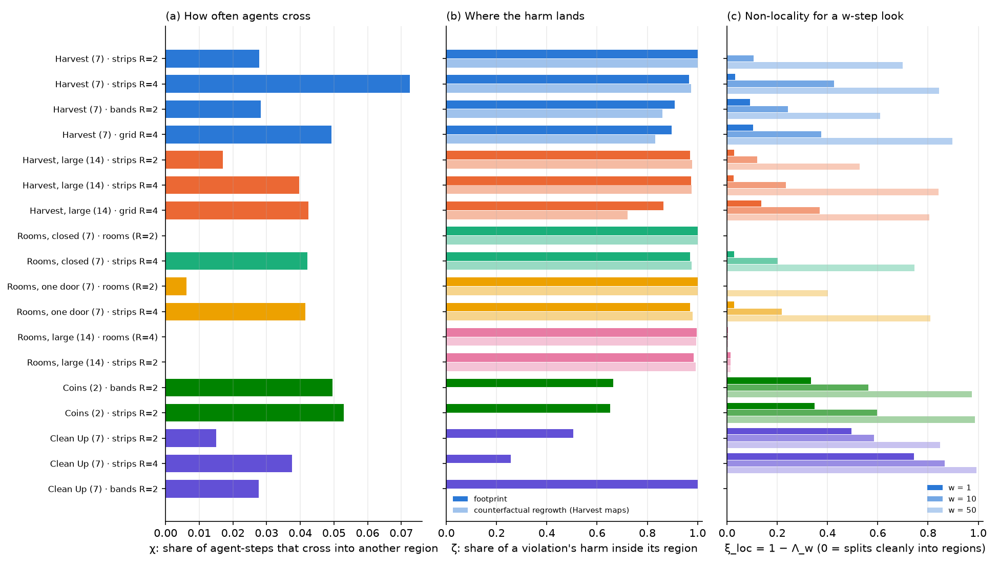
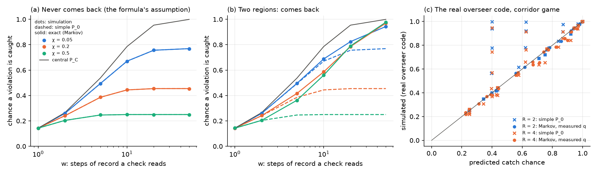
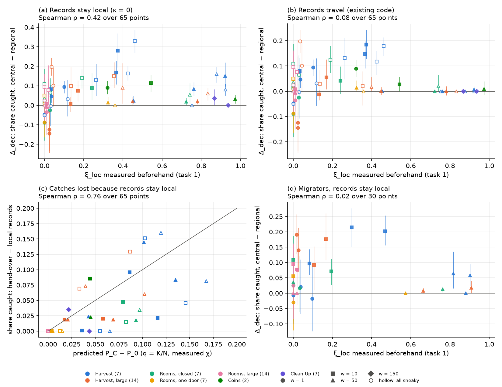
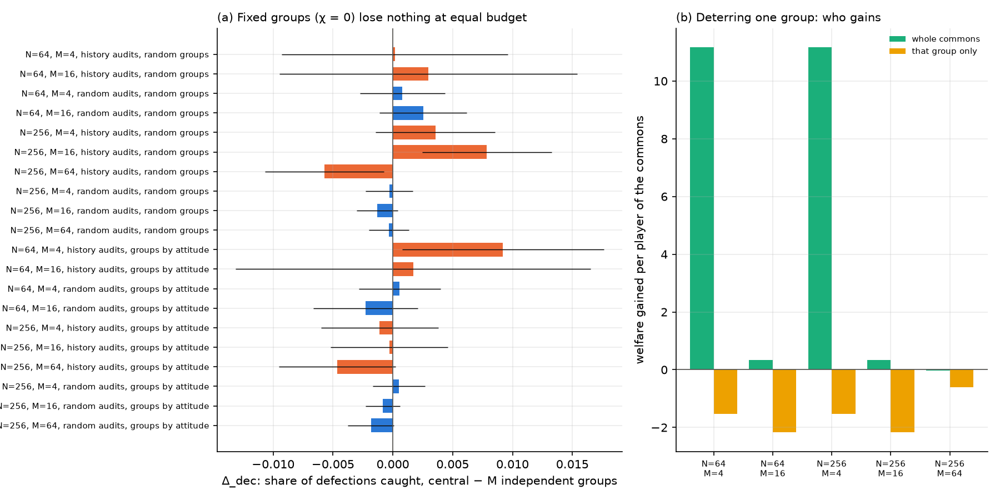

# Locality and scale: results (22 Nov 2026)

Protocol, with the predictions written before any run: `protocol.md`. Branch `claude/locality-scale`. Every table
here is printed by `experiments/socialjax/analyze_locality.py`; the full tables (every population, every point)
are in `tables.md`, the numbers in `locality_numbers.json`. **Everything here uses scripted bots** (and, in task 4,
fixed LLM-written strategies). None of it is a learning-agent result yet; the trained-agent measurement is
prepared for CREATE (section 6).

## Summary

1. **The existing regional overseer hands records over for free** (section 0), so findings 12–16 and the 159 GPU
   runs measure only where checks can go. `LocalRecordOverseer` adds independent overseers.
2. **Locality, measured** (section 1). Harvest's harm is local (ζ 0.86–1.00) but its agents roam (χ 0.017–0.073 per
   agent-step), so ξ_loc is near 0 for a 1-step look and 0.5–0.9 for a 50-step look. Closed rooms: χ = 0 and
   ξ_loc = 0. Coins: ζ 0.67. Clean Up: ζ 0.50 (2 strips), 0.26 (4 strips), but 1.00 for a river/orchard split.
3. **P_0 is right only when agents never come back** (section 2): exact then, off by up to 0.73 with 2–4 regions.
   An exact Markov version fits within 0.003, and the real code within 0.03–0.04.
4. **ξ_loc predicts the evidence-loss part of the gap (ρ = 0.80), not the total gap (ρ = 0.42)** (section 3). Most
   of the gap is placement: fixed per-region budgets while agents crowd unevenly.
5. **At scale with fixed groups, splitting costs nothing and ζ doesn't enter catching** (section 4): N = 64 and
   256, M up to 64, |Δ| ≤ 0.01. Each overseer reads N/M records; a pooled budget costs 2M numbers per round (3–50%
   of central collection). ζ decides what a group-selfish overseer wants: deterring its own group is a loss to that
   group at every M ≥ 4.
6. **Predictions:** 21 written; 13 held, 4 in part, 3 failed, 1 untested (section 5).

**What this changes in the formulation:** split ξ_loc (χ and budget density for catching; ζ for the overseers'
objective); replace §5.2's P_0 with the Markov form; report time-to-catch as well as catch share; rerun the
decentralised GPU comparison with local records, or state that the 159 runs test placement only.

## 0. Read this first: the existing regional overseer hands records over for free

`DecentralisedOverseer` keeps each agent's record of its last w steps *with the agent*, and a check by any
regional overseer reads all of it, including steps spent in other regions. That is a full hand-over between
overseers (κ = ∞ in the formulation's §3.3) that costs nothing. So:
- in the existing code, crossing a boundary never hides a violation; splitting only changes **where checks can
  go** (each region's budget is fixed at K/R whatever the number of agents there);
- findings 12–16 and the 159 decentralised GPU runs measure that placement effect only, not evidence lost at
  boundaries;
- the P_0 formula (§5.2) is about **independent** overseers that see only their own region's steps.

This study adds that version, `LocalRecordOverseer(records="local")` in `overseer/socialjax/local_records.py`.
With `records="handover"` it reproduces the existing overseer step for step (tested, two configurations). Every
comparison below runs both, so the gap splits into two parts:
- **placement:** central − regional with hand-over (checks stuck in the wrong region);
- **evidence loss:** regional with hand-over − regional with local records (violations seen by nobody because the
  agent left).

## 1. Task 1: locality, measured

Scripted bots, 999 steps, 10 seeds (5 for 14 agents), 4 populations (all honest; 1 greedy + rest honest; all
sneaky; all migrator). χ is pooled over the populations; ζ over all violations; ξ_loc is measured directly (the
mean over violations of "stayed in its region for the whole window" × ζ).

| Testbed | Regions | χ: crossings per agent-step (range over populations) | violations | ζ footprint | ζ counterfactual regrowth | ξ_loc, w = 1 | w = 10 | w = 50 |
|---|---|---|---|---|---|---|---|---|
| Harvest (7) | strips R=2 | 0.028 (0.018–0.039) | 827 | 1.000 | 1.000 | 0.000 | 0.107 | 0.698 |
| Harvest (7) | strips R=4 | 0.073 (0.063–0.084) | 945 | 0.967 | 0.973 | 0.033 | 0.426 | 0.845 |
| Harvest (7) | bands R=2 | 0.028 (0.022–0.034) | 939 | 0.909 | 0.860 | 0.091 | 0.243 | 0.609 |
| Harvest (7) | grid R=4 | 0.049 (0.045–0.054) | 912 | 0.896 | 0.831 | 0.104 | 0.375 | 0.898 |
| Harvest, large (14) | strips R=2 | 0.017 (0.009–0.025) | 689 | 0.971 | 0.978 | 0.029 | 0.120 | 0.528 |
| Harvest, large (14) | strips R=4 | 0.040 (0.030–0.046) | 869 | 0.974 | 0.976 | 0.026 | 0.234 | 0.842 |
| Harvest, large (14) | grid R=4 | 0.042 (0.039–0.048) | 899 | 0.863 | 0.722 | 0.137 | 0.369 | 0.806 |
| Rooms, closed (7) | the two rooms | **0** | 391 | 1.000 | 1.000 | **0** | **0** | **0** |
| Rooms, closed (7) | strips R=4 | 0.042 | 725 | 0.971 | 0.977 | 0.029 | 0.203 | 0.746 |
| Rooms, one door (7) | the two rooms | 0.006 (0.002–0.014) | 749 | 1.000 | 1.000 | 0.000 | 0.000 | 0.402 |
| Rooms, large (14) | the four rooms | **0** | 331 | 0.997 | 0.994 | 0.003 | 0.003 | 0.003 |
| Coins (2) | bands R=2 | 0.050 (0.045–0.062) | 418 | 0.665 (victim in the thief's region) | – | 0.335 | 0.562 | 0.975 |
| Clean Up (7) | strips R=2 | 0.015 (0.009–0.023) | 733 | 0.504 (share of empty orchard) | – | 0.496 | 0.586 | 0.848 |
| Clean Up (7) | strips R=4 | 0.038 (0.028–0.043) | 742 | 0.257 | – | 0.743 | 0.866 | 0.994 |
| Clean Up (7) | bands R=2 | 0.028 (0.018–0.049) | 733 | **1.000** | – | 0.000 | 0.000 | 0.000 |



*Figure 1. (a) How often agents change region. (b) The share of a violation's harm that lands in its own
region. (c) ξ_loc for a check that reads 1, 10 or 50 steps: 0 means the game splits cleanly into regions.*

**What it says.**
- **Harvest Open's harm is local; its agents are not.** ζ is 0.86–1.00 on every layout (patches sit 3 or more
  cells apart, so a violation's footprint rarely crosses a boundary), but agents cross every 14–40 steps. So ξ_loc
  is near 0 for a 1-step look and 0.5–0.9 for a 50-step look. Non-locality in Harvest comes from movement.
- **Rooms switch χ off and leave everything else alone.** Closed rooms: χ = 0 exactly and ξ_loc = 0 at every w.
  One door: χ = 0.006 per agent-step (one crossing per 160 steps). If regions don't follow the walls (rooms map,
  strips R = 4), ξ_loc is as high as on the open map: rooms only help when the overseers' regions are the rooms.
- **Clean Up's ζ depends on the split.** Strips cut the orchard, so the harm of free-riding (lower regrowth
  everywhere) spreads in proportion: ζ = 0.50 for 2 strips, 0.26 for 4. Bands separate river from orchard, and every
  violation (eating) happens in the orchard band where all the harm also lands: ζ = 1. "Clean Up has global harm"
  is true of the map, not of every region design.
- **The counterfactual and the footprint agree** to within 0.06 except on the grid layouts (0.83 vs 0.90 in
  Harvest; 0.72 vs 0.86 on the large map), where regrowth cascades carry some harm over a boundary that cuts a patch.
- **The formula (1 − χ)^{w−1} for "evidence stays" is only rough.** Violators often stay longer than it says
  (1 greedy, strips R = 2: stays 10 steps 97% of the time against 85% predicted), because a violator is usually
  stripping a patch and lingers. It underestimates more often than it overestimates (per-population table in
  `tables.md`).

## 2. Task 2: the catch formula against simulation



*Figure 2. Chance a violation is ever caught, q = 1/7 per step. Dots: simulation (200,000 violations each); dashed:
the formula P_0; solid: the exact version with returns (`locality.p0_markov`); grey: the central P_C. (c) The real
overseer code (`LocalRecordOverseer`, fixed K/R checks per region) on the corridor game, 8 agents, K = 2.*

| Crossing pattern | worst |simulation − P_0| | worst |simulation − exact Markov P_0| |
|---|---|---|
| never comes back (the formula's assumption) | 0.002 | 0.002 |
| two regions | **0.727** (χ = 0.5, w = 50) | 0.003 |
| ring of four | **0.598** (χ = 0.5, w = 50) | 0.002 |

Over q ∈ {0.05, 1/7, 2/7}, χ ∈ {0, 0.01, 0.05, 0.2, 0.5}, w ∈ {1, 2, 5, 10, 20, 50}, α ∈ {0, 0.5}: 180 cells per
pattern.

**Where the formula holds and where it breaks.**
- **It is exact when its assumption holds** (agents never come back within the window): within Monte Carlo error
  everywhere.
- **It breaks when agents come back,** which in any map with a few regions they do. A returning agent meets its
  old overseer, whose record of the violation is still there. So the loss is temporary: for a long enough window
  the independent overseers catch nearly everything the central one does. With two regions, χ = 0.2 and w = 50, the
  true chance is 0.97 against the formula's 0.45 and a central 1.00. The formula says P_0 tends to q/(q + χ − qχ);
  that limit is wrong whenever the agent can return. **The largest loss is at mid-length windows** (w ≈ 5–20 at
  these rates), not at long ones.
- **The exact replacement is a short Markov-chain sum** (`p0_markov`): the chance the record is still pending and
  the agent is in region s, pushed through the crossing matrix one step at a time. It matches every cell.
- **In the real overseer code, budgets add a second error.** Each region checks K/R agents whatever its
  occupancy. With 2 regions the Markov formula with q = K/N is within 0.03 of the simulation; with 4 regions and
  K = 2 (two regions checked per step, sometimes empty ones) it is off by up to 0.06, and using the measured
  per-agent check rate (0.225 instead of 0.25) brings it to within 0.04. The simple P_0 is off by up to 0.60.
- **At w = 1, P_0 = P_C** in every version, as derived; the only loss left is placement (R = 4: 0.22–0.23 caught
  against 0.25, because checks go to empty regions).

**Recommendation for the formulation (§5.2):** keep the simple P_0 only as the no-return case and replace it with
the Markov form for any finite set of regions.

## 3. Task 3: does locality predict the decentralisation gap (D1)?

Random checks at equal total budget (K = 2; 4 for 14 agents; 1 in Coins), a 50-step freeze on a catch, 10 seeds
(5 for 14 agents), central vs regional with local records vs regional with hand-over. 127 conditions × 3
populations. Δ_dec = share of violations caught by the central overseer − by the regional ones, with a bootstrap
95% interval over seeds. Points with fewer than 20 violations are dropped (most Clean Up populations never break
its rule).



*Figure 3. Each point is one testbed × layout × window × population. (a) Total gap with local records; (b) total gap
with hand-over; (c) the part due to records staying local against the formula's prediction P_C − P_0; (d)
migrators. Filled: 1 greedy + rest honest; hollow: all sneaky.*

| What is compared | Spearman ρ with ξ_loc | points |
|---|---|---|
| total gap, local records | 0.42 | 65 |
| total gap, hand-over (existing code) | 0.08 | 65 |
| **evidence-loss part** (hand-over − local) | **0.80** (0.85 with 1 − S_w alone; 0.76 with the formula P_C − P_0) | 65 |
| total gap, migrators, local records | 0.02 | 30 |
| evidence-loss part, migrators | 0.69 | 33 |

Mean gap over the 21 non-migrator points at each window (local records / hand-over): w = 1: 0.007 / 0.007; w = 10:
0.106 / 0.072; w = 50: 0.040 / 0.005.

**What it says.**
1. **ξ_loc predicts the part of the gap it was built for, and not the rest.** The catches lost because records
   stay local rank with ξ_loc (ρ = 0.80), and the derived P_C − P_0 gets their size about right (0.00–0.17
   predicted, 0.00–0.16 measured; panel c). Many points are exactly 0 (closed rooms, w = 1), which helps the rank
   correlation, so read ρ as a lead from 7 maps, not 65 independent tests.
2. **The bigger part of the gap is placement, which locality doesn't measure.** At w = 1 local and hand-over are
   identical, yet the gap runs from −0.15 to +0.20: a region crowded with agents checks each one less often, an
   empty one wastes its checks. At w = 10 hand-over still loses 0.07 on average, including 0.11 in closed rooms
   with sneaky bots (ξ_loc = 0). A predictor for the total gap needs a second number: how unevenly agents spread
   over regions relative to the budget (the spread of d_m in the formulation's D2).
3. **Rooms work as predicted for evidence, not for placement.** Closed rooms with rooms as regions: local =
   hand-over in every cell (nothing to lose at a boundary nobody crosses), and the total gap at w = 50 is 0.00 (1
   greedy) and 0.035 (sneaky). Harvest Open at w = 50 loses 0.02–0.16 with local records. But at w = 10 closed rooms
   still lose 0.11 with sneaky bots, from placement.
4. **Long windows hide the gap.** At w = 50 the central overseer catches 100% of violations in every Harvest cell,
   so the gap can only shrink there, and agents that come back are caught late rather than never (section 2). A
   catch-share gap at long windows understates the cost: a late catch is a weaker deterrent. Time-to-catch would be
   the better measure for the learning-agent runs.
5. **Migrators exploit placement.** Their gap at w = 10 is 0.06–0.22 whatever ξ_loc is (ρ = 0.02), as expected
   from bots that seek out regions whose overseer hasn't checked them lately.
6. **Welfare (Δη) is noisy with bots** (the freeze is the only consequence they feel) and is in `tables.md`;
   it is not used for conclusions.

## 4. Task 4: scale, in Willis et al.'s commons

N = 64 and 256 players in one game of Willis, Zhao, Du & Leibo's Common Pool Resource (20 rounds, capacity 4N),
strategies drawn from their committed LLM-written pool (no LLM calls), 50 games per N. K = N/8 audits per round.
The strategies never see audits, so each overseer design is applied to the same defection record (exact here;
`experiments/scale/groups.py`). M fixed groups of N/M; each group's overseer audits K/M of its own group. These games
are harsh: 46–47% of choices are D and the stock ends at 3–8 of 256–1,024.

| N | M | Audits | central caught | M groups caught | Δ_dec (± 95%) | numbers sent between overseers per round, % of the N records a central overseer collects |
|---|---|---|---|---|---|---|
| 64 | 4 | random | 0.124 | 0.124 | +0.001 (± 0.004) | 0% |
| 64 | 16 | random | 0.124 | 0.122 | +0.003 (± 0.004) | 0% |
| 256 | 4 | random | 0.124 | 0.124 | −0.000 (± 0.002) | 0% |
| 256 | 64 | random | 0.124 | 0.124 | −0.000 (± 0.002) | 0% |
| 64 | 4 | history-first | 0.164 | 0.164 | +0.000 (± 0.009) | 0% |
| 64 | 4 | history-first, groups by attitude | 0.164 | 0.155 | +0.009 (± 0.008) | 0% |
| 256 | 16 | history-first | 0.149 | 0.141 | +0.008 (± 0.005) | 0% |
| 256 | 64 | history-first | 0.149 | 0.155 | −0.006 (± 0.005) | 0% |
| 256 | 16 | history-first, pooled budget | 0.149 | 0.141 | +0.008 (± 0.005) | 12.5% |

All 40 rows: `tables.md`.



*Figure 4. (a) Gap between central and M independent group overseers at equal budget: within ±0.01 everywhere.
(b) What deterring one group is worth to the whole commons and to that group, every other group complying.*

**What it says.**
1. **With χ = 0, splitting costs nothing at any scale tested.** Random audits: |Δ_dec| ≤ 0.003 at N = 64 and 256,
   M up to 64. History-first: within ±0.01. Yet ξ_loc = 1 − 1/M = 0.75–0.98 here, because ζ = 1/M (one shared
   stock). **So ζ does not affect catching at all.** Multiplying χ and ζ into one number mixes two different
   things; for catching only χ (with w and placement) matters.
2. **ζ matters for what an overseer wants.** If each group's overseer counts only its own group's welfare
   (version b), deterring its own group is a loss to that group for every M ≥ 4 (N = 64, M = 4: the commons gains
   714 units, the deterred group *loses* 98, because its own extra extraction outweighs its 1/4 share of the stock
   damage). Such an overseer would not deter at any audit cost. This is a derived result with always-C/always-D
   players, not a simulation of overseers that choose.
3. **Communication.** Independent groups send nothing between overseers; each reads N/M records instead of N.
   Pooling the budget (each overseer sends one count, gets back one budget) costs 2M numbers per round: 3% of
   central collection at N = 256, M = 4, up to 50% at M = N/4. Pooling recovered nothing because nothing was lost;
   with random audits it raised catches by 1–3 points, because it steers checks to groups with known defectors
   (a form of targeting, not a fix for decentralisation).
4. **What this is a reason for.** At equal total audits the work per overseer falls from N to N/M records per
   round, at no catch cost, when agents stay in their groups. That is the scale argument the devil's advocate note
   asked for, measured. It is weaker than the Du papers' "5–35% of centralised", because here every record is still
   read by someone: the saving is in what must reach one place and in each overseer's load, not in total reading.

## 5. Predictions against results

| # | Prediction (protocol) | Result | Verdict |
|---|---|---|---|
| 1 | Harvest strips R = 2: χ 0.005–0.03, ζ ≥ 0.95, ξ ≤ 0.05 / 0.05–0.25 / 0.2–0.8 | χ 0.028 (migrators 0.039), ζ 1.00, ξ 0.00 / 0.11 / 0.70 | held |
| 2 | Strips R = 4: χ 2–3 × R = 2; ζ 0.7–0.95 | 2.6 ×; ζ 0.97 | partly (ζ higher) |
| 3 | Grid R = 4 between; ζ 0.7–0.95 | χ 0.049; ζ 0.90 | held |
| 4 | Large map: ζ 0.8–0.95 | strips 0.97, grid 0.86 | partly (strips higher) |
| 5 | Closed rooms: χ = 0, ζ = 1, ξ = 0 | exactly | held |
| 6 | One door: χ ≤ 0.003; ξ ≤ 0.02 / 0.05 / 0.15 | χ 0.006; ξ 0.00 / 0.00 / 0.40 | failed (more crossing; w = 50) |
| 7 | Rooms with misaligned regions: ξ > 0 | 0.03 / 0.20 / 0.75 | held |
| 8 | Coins: χ 0.03–0.15, ζ 0.3–0.7, ξ ≥ 0.3 at w = 1, near 1 at w = 50 | 0.050, 0.67, 0.34, 0.98 | held |
| 9 | Clean Up strips R = 2: χ 0.005–0.03, ζ 0.3–0.7, ξ ≥ 0.3 | 0.015, 0.50, 0.50–0.85 | held (but bands give ζ = 1, not predicted) |
| 10 | S_w below (1 − χ)^{w−1} for migrators, ≈ for others | violators mostly stay *longer* than predicted, migrators included | failed |
| 11 | Counterfactual ζ ≤ footprint ζ, by < 0.1 | yes, by ≤ 0.07, except the large-map grid (0.14) | mostly held |
| 12 | P_0 exact under drift | ≤ 0.002 | held |
| 13 | P_0 underestimates with returns; Markov fits | errors up to 0.73; Markov ≤ 0.003 | held |
| 14 | Real code: q = K/N off with uneven occupancy; measured q fixes most | within 0.03 (R = 2), 0.04 (R = 4) with measured q | held |
| 15 | Δ_dec (local) grows with ξ_loc, ρ ≥ 0.6 | total gap ρ 0.42; evidence part ρ 0.80 | failed for the total, held for the part ξ is about |
| 16 | Closed rooms Δ ≤ 0.05 at w = 50; Open ≥ 0.15 | rooms 0.00–0.035; Open 0.02–0.16 (only grid R = 4 reaches 0.15) | partly |
| 17 | Hand-over gap doesn't grow with w | it shrinks (0.007, 0.072, 0.005) | held |
| 18 | Willis, random: |Δ| ≤ 0.01 | ≤ 0.003 | held |
| 19 | Willis, history: independent loses ≤ 0.05, pooling recovers most | loses ≤ 0.009; nothing to recover | held (trivially) |
| 20 | Version (b): a group overseer audits only below 1/M of the team's cost | stronger: deterring its own group is a net loss to the group at every M ≥ 4 | held, stronger |
| 21 | Trained agents cross 2–5 × the bots | not run (CREATE, section 6) | untested |

Deviation from the protocol: the third ζ measure ("counterfactual with agents") was not run. With reactive bots,
"the same episode without the violation" is ill-defined (the bot eats the restored apple a step later), so it
would have measured a one-step delay. The regrowth-only counterfactual and the footprint are reported instead.
Task 1's bot rollouts used K = 4 for 14 agents and K = 1 in Coins (the task 3 budgets), not 2 everywhere.

## 6. Trained IPPO agents (prepared, not run)

`scripts/create/measure_locality_ippo.sbatch` loads each stage 1 run's `params.msgpack` with the trainer's own
network (imported, not edited), plays 32 episodes under that run's own overseer settings, and measures χ, S_w, ζ
and Λ_w for every layout. Tested locally with randomly initialised parameters. On a CREATE login node:

```bash
WORK=/scratch/users/$USER/socialjax_work
git clone -b claude/locality-scale https://github.com/TallowCatch/invasion-commons.git $WORK/invasion-commons-loc
cp $WORK/invasion-commons-loc/scripts/create/measure_locality_ippo.sbatch ~/ippo/
sbatch --export=ALL,REPO=$WORK/invasion-commons-loc ~/ippo/measure_locality_ippo.sbatch
# output: /scratch/users/$USER/ippo_overseer/locality/locality_ippo.json; then, locally,
# copy it to results/locality/ and compare with measure.json (same row format)
```

Default runs: `A_none_seed1-3`, `B_random_k{1,2,4,7}_c1.0_seed1`, `B_random_k2_c{0.5,2.0}_seed1`,
`D_history_k2_c1.0_seed1`, `D_location_k2_c1.0_seed1` (runs without params are skipped). `RUNS=...` overrides.

## 7. Files

| File | What |
|---|---|
| `overseer/socialjax/local_records.py` | `LocalRecordOverseer`: independent regional overseers that see only their own region (κ = 0), or the existing hand-over; any region map |
| `overseer/socialjax/rooms.py` | Harvest rooms maps (closed, one door, 14-agent four rooms) and bots that walk round walls |
| `overseer/socialjax/locality.py` | χ, S_w, ζ (footprint, counterfactual regrowth, Clean Up, Coins), Λ_w, ξ_loc; P_C, P_0 and the exact Markov P_0 |
| `overseer/socialjax/corridor.py` | toy corridor game and a crossing bot with set χ |
| `experiments/socialjax/measure_locality.py` | task 1 (bots; `--params-root` for trained agents) |
| `experiments/socialjax/measure_locality_formula.py` | task 2 |
| `experiments/socialjax/measure_locality_gap.py` | task 3 |
| `experiments/socialjax/analyze_locality.py` | tables and figures |
| `experiments/scale/groups.py`, `run_scale.py` | task 4 |
| `scripts/create/measure_locality_ippo.sbatch` | trained-agent measurement on CREATE |
| `tests/test_locality.py` | 12 tests |

Raw outputs (git-ignored): `results/locality/{measure,formula,gap,scale}.json`. Commands:
`.venv-socialjax/bin/python -m experiments.socialjax.measure_locality` (about 20 min),
`... measure_locality_formula` (5 min), `... measure_locality_gap` (about 3 h on a busy laptop; two processes
over different testbeds halve it), `.venv/bin/python -m experiments.scale.run_scale` (30 s), then
`... analyze_locality`.
